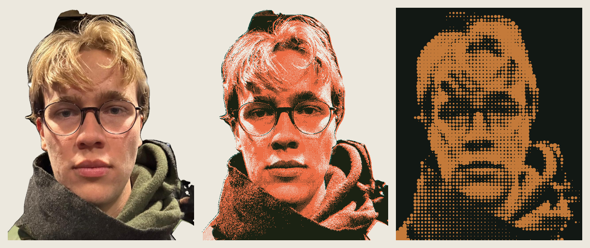
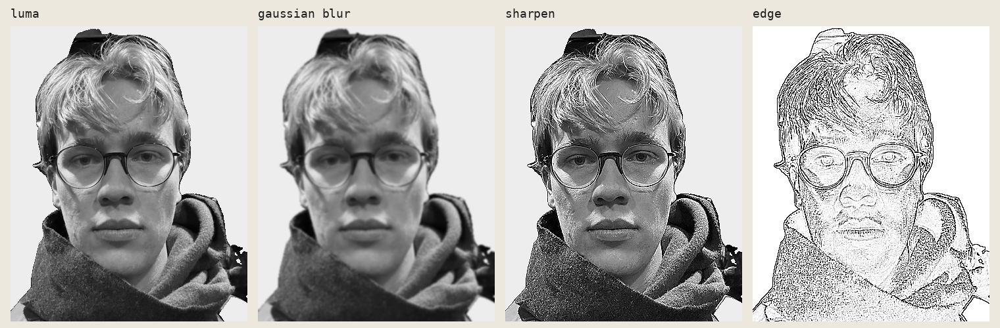

# portrait-filters

The two portrait filters on [jplepecki.tech](https://jplepecki.tech): a two-colour **risograph** and **copper halftone** dots on a circuit board. Plain NumPy and Pillow, every step explained.



Write-up: [How a photo becomes a riso print](https://jplepecki.tech/posts/how-a-photo-becomes-a-riso-print/)

## Run it

```bash
pip install -r requirements.txt
python -m portrait_filters riso   my_photo.png riso.png
python -m portrait_filters copper my_photo.png copper.png
```

- A **transparent PNG** cutout (background removed) gives the cleanest result; any background remover works.
- `--gamma 1.5` darkens mid-tones, which helps flash photos. `--width` sets the working resolution (default 480 px).

## How it works

| Step | File | What it does |
| --- | --- | --- |
| RGB → luma | `kernels.py` | One brightness value per pixel, weighted 0.21 R + 0.72 G + 0.07 B |
| Tone | `kernels.py` | Percentile stretch (riso) or histogram equalisation + local contrast (copper) |
| Sharpen | `kernels.py` | Unsharp mask: add back what a 3×3 Gaussian blur removes |
| Riso | `filters.py` | Two thresholds → two ink layers, each Bayer-dithered, light layer offset, multiply-blended |
| Halftone | `filters.py` | 9×9 cells → one copper dot each, radius set by the cell's brightness |

The kernels themselves (box blur, Gaussian, sharpen, edge) are in `kernels.py` with a plain-loop `convolve` so you can see exactly what a convolution does:



Why this exists and what was deliberately left out: [docs/gates.md](docs/gates.md).

## License

MIT
